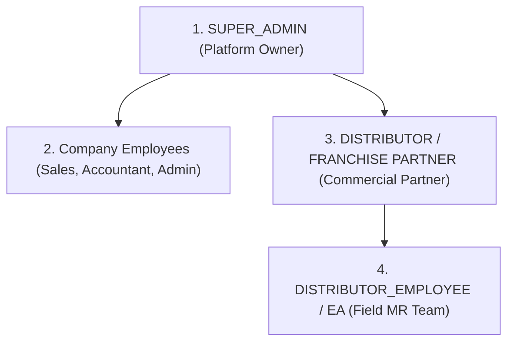

# Pharma CRM — Production Working Login Details & Role Access Matrix

> **Environment:** Live Production (`https://crm.easysolutins24.in`)  
> **Auth Standard:** OAuth 2.0 Password Grant (`POST /api/v1/oauth/token`)  
> **Password Cryptography:** Argon2id (`$argon2id$v=19$m=65536,t=4,p=1$...`)  
> **Verification Status:** Verified & Active in Live Production Database

---

## 1. Hierarchy & Role Definitions

As per the approved [Pharma CRM — Login & Role Access Specification](file:///d:/yashwant/Pharma-CRM/USER_ACCESS_CONTROL_AND_WORKFLOWS_PLAN.md):



| Role Enum | Role Title | Hierarchy Level | Data Isolation & Scope Boundary |
|---|---|---|---|
| `SUPER_ADMIN` | Platform Super Admin | Top-Level Platform Owner | Company-wide visibility across all franchises and distributors. **Cannot view EA Rep isolated operational data.** |
| `FRANCHISE_ADMIN` | Franchise Owner / Admin | Franchise Branch Lead | Full operational control of the assigned franchise (`MUMBAI`). |
| `SALES` | Sales Representative | Company Employee | Assigned leads, field follow-ups, and orders within the franchise. |
| `ACCOUNTANT` | Accountant / Billing Lead | Company Employee | Invoicing, payments, ledger audits, order financial approvals within the franchise. |
| `DISTRIBUTOR` | Distributor / Franchise Partner | Commercial Partner | Distributor portal self-service, inventory orders, own party ledger, and **full oversight of own EA team**. |
| `DISTRIBUTOR_EMPLOYEE` | EA Representative (MR) | Distributor Field Team | Strictly scoped to own leads, follow-ups, reports, and payments. **Invisible to Super Admin & Company users.** |

---

## 2. Production Working Login Credentials

All users are seeded with the standard production baseline password: `Password@123`.

| # | Role Enum | Full Name | Production Email | Password | OAuth Client ID | Franchise Code | Linked Party Ref |
|---|---|---|---|---|---|---|---|
| 1 | `SUPER_ADMIN` | Platform Super Admin | `super@pharmacrm.local` | `Password@123` | `crm-super` | *(None / Platform)* | `NULL` |
| 2 | `FRANCHISE_ADMIN` | Mumbai Franchise Admin | `admin@pharmacrm.local` | `Password@123` | `crm-admin` | `MUMBAI` | `NULL` |
| 3 | `SALES` | Rajesh Sales | `sales@pharmacrm.local` | `Password@123` | `crm-admin` | `MUMBAI` | `NULL` |
| 4 | `ACCOUNTANT` | Suresh Accountant | `accountant@pharmacrm.local` | `Password@123` | `crm-admin` | `MUMBAI` | `NULL` |
| 5 | `DISTRIBUTOR` | Apollo Distributor Admin | `portal@pharmacrm.local` | `Password@123` | `crm-portal` | `MUMBAI` | `PAR-APOLLODIST00001` |
| 6 | `DISTRIBUTOR_EMPLOYEE` | Vikram EA Rep | `ea@pharmacrm.local` | `Password@123` | `crm-portal` | `MUMBAI` | `PAR-APOLLODIST00001` |

---

## 3. OAuth 2.0 Token Generation Guide

Tokens are issued via `POST /api/v1/oauth/token` with `Content-Type: application/x-www-form-urlencoded` or JSON.

### 3.1 Super Admin (`SUPER_ADMIN`)
```bash
curl -X POST "https://crm.easysolutins24.in/api/v1/oauth/token" \
  -H "Content-Type: application/x-www-form-urlencoded" \
  -d "grant_type=password" \
  -d "client_id=crm-super" \
  -d "email=super@pharmacrm.local" \
  -d "password=Password@123"
```

### 3.2 Franchise Admin (`FRANCHISE_ADMIN`)
```bash
curl -X POST "https://crm.easysolutins24.in/api/v1/oauth/token" \
  -H "Content-Type: application/x-www-form-urlencoded" \
  -d "grant_type=password" \
  -d "client_id=crm-admin" \
  -d "franchise_code=MUMBAI" \
  -d "email=admin@pharmacrm.local" \
  -d "password=Password@123"
```

### 3.3 Sales Team Member (`SALES`)
```bash
curl -X POST "https://crm.easysolutins24.in/api/v1/oauth/token" \
  -H "Content-Type: application/x-www-form-urlencoded" \
  -d "grant_type=password" \
  -d "client_id=crm-admin" \
  -d "franchise_code=MUMBAI" \
  -d "email=sales@pharmacrm.local" \
  -d "password=Password@123"
```

### 3.4 Company Accountant (`ACCOUNTANT`)
```bash
curl -X POST "https://crm.easysolutins24.in/api/v1/oauth/token" \
  -H "Content-Type: application/x-www-form-urlencoded" \
  -d "grant_type=password" \
  -d "client_id=crm-admin" \
  -d "franchise_code=MUMBAI" \
  -d "email=accountant@pharmacrm.local" \
  -d "password=Password@123"
```

### 3.5 Distributor / Franchise Partner (`DISTRIBUTOR`)
```bash
curl -X POST "https://crm.easysolutins24.in/api/v1/oauth/token" \
  -H "Content-Type: application/x-www-form-urlencoded" \
  -d "grant_type=password" \
  -d "client_id=crm-portal" \
  -d "franchise_code=MUMBAI" \
  -d "email=portal@pharmacrm.local" \
  -d "password=Password@123"
```

### 3.6 Distributor Employee / EA Rep (`DISTRIBUTOR_EMPLOYEE`)
```bash
curl -X POST "https://crm.easysolutins24.in/api/v1/oauth/token" \
  -H "Content-Type: application/x-www-form-urlencoded" \
  -d "grant_type=password" \
  -d "client_id=crm-portal" \
  -d "franchise_code=MUMBAI" \
  -d "email=ea@pharmacrm.local" \
  -d "password=Password@123"
```

---

## 4. Successful OAuth Response Envelope

When authenticated successfully, the server returns an HTTP 200 response with the standard token envelope:

```json
{
  "token_type": "Bearer",
  "expires_in": 86400,
  "access_token": "eyJhbGciOiJIUzI1NiIsInR5cCI6IkpXVCJ9...",
  "refresh_token": "def50200...",
  "user": {
    "user_ref": "USR-EAREPRESENT000001",
    "email": "ea@pharmacrm.local",
    "full_name": "Vikram EA Rep",
    "role": "DISTRIBUTOR_EMPLOYEE",
    "party_ref": "PAR-APOLLODIST00001",
    "tenant_key": "FRN-MUMBAI000000000001",
    "franchise_ref": "FRN-MUMBAI000000000001"
  }
}
```

---

## 5. Security & Isolation Matrix (Section 6 Enforced)

| Action / Resource | Super Admin | Company Sales / Accountant | Distributor | EA Rep (Field MR) |
|---|:---:|:---:|:---:|:---:|
| **Create Company Users** | ✅ | ❌ | ❌ | ❌ |
| **Create Distributor Account** | ✅ | ✅ (Sales) | ❌ | ❌ |
| **Distributor Self-Registration Approval** | ✅ | ❌ | ❌ | ❌ |
| **Create EA Team Members** | ❌ | ❌ | ✅ | ❌ |
| **Create & Log Leads / Follow-ups** | ✅ | ✅ | ✅ | ✅ (Own leads only) |
| **Place Orders** | ✅ | ✅ | ✅ | ✅ |
| **Approve EA Orders** | ❌ | ❌ | ✅ | ❌ |
| **View EA Field Data & Performance** | ❌ (Strictly blocked) | ❌ (Strictly blocked) | ✅ (Own team only) | ✅ (Own data only) |
| **Track Pending Payments** | ✅ | ✅ | ✅ (Own ledger) | ✅ (Own follow-ups) |
